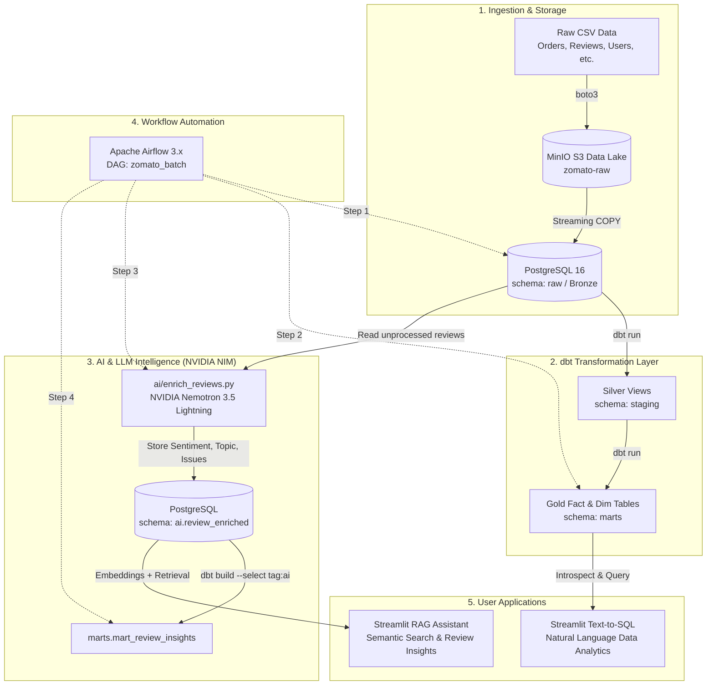

# 🍔 Zomato AI-Powered Data Engineering Platform

[](https://www.python.org/)
[](https://www.postgresql.org/)
[](https://www.getdbt.com/)
[](https://airflow.apache.org/)
[](https://min.io/)
[](https://build.nvidia.com/)
[](https://streamlit.io/)

An enterprise-grade, end-to-end **Data Engineering & Generative AI Platform** modeled after Zomato's food delivery business. 

The platform implements a modern **Medallion Architecture (Bronze ➔ Silver ➔ Gold ➔ AI Enriched)** that ingests raw operational data into an S3-compatible object storage lakehouse, transforms it via **dbt**, automates DAG runs with **Apache Airflow**, enriches customer reviews using **NVIDIA Nemotron 3.5 Lightning (30B-A3B)**, and serves conversational **RAG** and **Text-to-SQL** analytics via **Streamlit**.

---

## 📑 Table of Contents
- [Architecture Overview](#-architecture-overview)
- [Key Features](#-key-features)
- [Tech Stack](#-tech-stack)
- [Repository Structure](#-repository-structure)
- [Data Pipeline & Medallion Architecture](#-data-pipeline--medallion-architecture)
- [AI & Generative Intelligence](#-ai--generative-intelligence)
  - [1. LLM Review Enrichment](#1-batch-review-enrichment)
  - [2. RAG Review Assistant](#2-semantic-rag-assistant)
  - [3. Text-to-SQL Analytics Assistant](#3-natural-language-text-to-sql-assistant)
- [Database Security & RBAC](#-database-security--rbac)
- [Getting Started / Quickstart Guide](#-getting-started--quickstart-guide)
  - [1. Prerequisites](#1-prerequisites)
  - [2. Environment Configuration](#2-environment-configuration)
  - [3. Start Infrastructure](#3-start-infrastructure-with-docker)
  - [4. Initialize Warehouse Schema & Roles](#4-initialize-warehouse-schema--roles)
  - [5. Ingest Raw Data into MinIO & PostgreSQL](#5-ingest-raw-data-into-minio--postgresql)
  - [6. Execute dbt Transformations](#6-execute-dbt-transformations)
  - [7. Run AI Review Enrichment](#7-run-ai-review-enrichment)
  - [8. Run Airflow Orchestration](#8-run-airflow-orchestration)
  - [9. Launch Streamlit Applications](#9-launch-interactive-streamlit-apps)
- [Airflow Orchestration DAG](#-airflow-orchestration-dag)
- [Troubleshooting & FAQs](#-troubleshooting--faqs)

---

## 🏛 Architecture Overview




---

## ✨ Key Features

1. **Scalable Data Lake Ingestion**:
   - MinIO S3 object store with automated bucket creation and MD5/size idempotency checks.
   - High-throughput streaming ingestion directly into PostgreSQL using binary/chunked `COPY FROM STDIN`.
2. **Kimball Dimensional Modeling with dbt**:
   - **Staging views**: data cleaning, type casting, snake_case normalization, and deduplication.
   - **Core marts**: `fct_orders`, `fact_order_items`, `dim_restaurants`, `dim_customer`, `dim_food`, and `dim_date`.
   - **Aggregated analytical marts**: `mart_daily_city_revenune`, `mart_delivery_sla`, `mart_restaurant_performance`, and `mart_review_insights`.
3. **NVIDIA Nemotron 3.5 Lightning Integration**:
   - Advanced zero-shot sentiment classification (`sentiment_score` from -1.0 to +1.0), granular topic tagging (`food quality`, `delivery`, `pricing`, `service`, `packaging`, `other`), and key problem extraction.
   - Multi-threaded concurrent processing via `ThreadPoolExecutor`.
   - Resilient JSON parsing using `json.JSONDecoder().raw_decode` to reliably process models with reasoning outputs.
4. **pgvector Semantic Search & RAG**:
   - Review embeddings generated using `nvidia/nemotron-3.5-embed-1b` (2048 dimensions).
   - Fast cosine distance retrieval with dynamic multi-faceted filters (city, sentiment, star rating).
5. **Safe Natural Language Text-to-SQL**:
   - Converts conversational business questions into optimized PostgreSQL queries.
   - SQL safety gate preventing destructive queries (`DROP`, `DELETE`, `UPDATE`, `ALTER`, etc.).
   - Interactive data visualizations with auto-rendered Bar, Line, and Area charts.
6. **Containerized Production Orchestration**:
   - Apache Airflow 3.x managing scheduled batch pipelines with automatic dependency execution and retries.
7. **Strict Database Security (RBAC)**:
   - Dedicated PostgreSQL roles (`loader`, `dbt_user`, `app_readonly`, `postgres`) enforcing least privilege.

---

## 🛠 Tech Stack

| Category | Technology | Description |
| :--- | :--- | :--- |
| **Data Lake** | [MinIO](https://min.io/) | High-performance, S3-compatible local object storage |
| **Warehouse** | [PostgreSQL 16](https://www.postgresql.org/) + [pgvector](https://github.com/pgvector/pgvector) | Relational analytical warehouse with vector embedding extensions |
| **Transformations** | [dbt Core](https://www.getdbt.com/) | Modular SQL ELT transformations and testing |
| **Orchestration** | [Apache Airflow 3.x](https://airflow.apache.org/) | Workflow scheduling and dependency management via Docker |
| **Primary LLM** | [NVIDIA Nemotron 3.5 Lightning (30B-A3B)](https://build.nvidia.com/) | Hybrid MoE reasoning model for review analysis & Text-to-SQL |
| **Embeddings** | [NVIDIA Nemotron 3.5 Embed (1B)](https://build.nvidia.com/) | 2048-dimensional dense vector embeddings |
| **Fallback LLM** | [Google Gemini 3.5 Flash Lite](https://ai.google.dev/) | Alternative high-speed LLM provider |
| **Web Applications** | [Streamlit](https://streamlit.io/) | Interactive interactive dashboards for RAG and Text-to-SQL |
| **Database Tooling** | [pgAdmin 4](https://www.pgadmin.org/) | Web-based PostgreSQL administration interface |

---

## 📂 Repository Structure

```text
zomato-ai-data-engineering/
├── ai/                               # AI applications and LLM pipelines
│   ├── .env                          # Local environment variables for AI scripts
│   ├── enrich_reviews.py             # Batch review enrichment script (Nemotron / Gemini)
│   ├── llm_provider.py               # Unified LLM client for NVIDIA NIM and Gemini
│   ├── rag_chat.py                   # Streamlit RAG review assistant app
│   ├── review_embeddings.parquet     # Cached 2048-dim vector embeddings
│   └── text_to_sql.py                # Streamlit Text-to-SQL analytics assistant
├── airflow/                          # Apache Airflow 3.x deployment
│   ├── .env                          # Environment variables for Airflow containers
│   ├── dags/
│   │   └── zomato_batch.py           # Production batch pipeline DAG
│   ├── docker-compose.yaml           # Airflow multi-container orchestration definition
│   └── Dockerfile                    # Custom Airflow image with dbt & Python dependencies
├── data/                             # Source CSV datasets
│   ├── food.csv                      # Food catalogue and dietary flags
│   ├── menu.csv                      # Restaurant menu pricing and items
│   ├── order_items.csv               # Line items per order
│   ├── orders.csv                    # Customer orders, timestamps, GMV, and delivery times
│   ├── restaurants.csv               # Restaurant locations, cuisines, and ratings
│   ├── reviews.csv                   # Customer reviews and text comments
│   └── users.csv                     # Customer profiles and demographic data
├── docs/                             # Project documentation and architecture diagrams
│   └── Zomato AI Data Engineering Pipeline.png
├── enrichment/                       # Backup/container copy of enrichment scripts
│   └── enrich_reviews.py             # Enrichment script mounted into Airflow containers
├── ingestion/                        # Data lake & warehouse ingestion scripts
│   ├── load_raw_from_minio.py        # Streams CSVs from MinIO into PostgreSQL raw schema
│   └── upload_to_minio.py            # Uploads local CSVs to MinIO S3 bucket
├── scripts/
│   └── setup_db.py                   # Database initialization and role provisioning script
├── sql/
│   ├── 01_setup.sql                  # Schema creation, extensions, and RBAC grants
│   └── 02_raw_tables.sql             # Raw table DDL definitions
├── zomato/                           # dbt transformation project
│   ├── dbt_project.yml               # dbt project configuration
│   ├── profiles/profiles.yml         # dbt connection profiles
│   └── models/
│       ├── staging/                  # Silver layer (views)
│       │   ├── stg_food.sql
│       │   ├── stg_menu.sql
│       │   ├── stg_order_items.sql
│       │   ├── stg_orders.sql
│       │   ├── stg_restaurants.sql
│       │   ├── stg_reviews.sql
│       │   └── stg_users.sql
│       └── marts/                    # Gold layer (analytical tables)
│           ├── dim_customer.sql
│           ├── dim_date.sql
│           ├── dim_food.sql
│           ├── dim_restaurants.sql
│           ├── fact_order_items.sql
│           ├── fct_orders.sql
│           ├── mart_daily_city_revenune.sql
│           ├── mart_delivery_sla.sql
│           ├── mart_restaurant_performance.sql
│           └── mart_review_insights.sql   # AI-enriched review mart
├── docker-compose.yml                # Core infrastructure (Postgres, MinIO, pgAdmin)
├── requirements.txt                  # Python dependencies
└── README.md                         # Project documentation
```

---

## 🔄 Data Pipeline & Medallion Architecture

The warehouse follows the industry-standard **Medallion Architecture**:

```text
┌─────────────────┐       ┌─────────────────┐       ┌─────────────────┐       ┌─────────────────┐
│     BRONZE      │ ────> │     SILVER      │ ────> │      GOLD       │ ────> │   AI ENRICHED   │
│  (schema: raw)  │       │(schema: staging)│       │ (schema: marts) │       │  (schema: ai)   │
└─────────────────┘       └─────────────────┘       └─────────────────┘       └─────────────────┘
 • Unmodified CSVs         • Cast data types         • Dimension tables        • Sentiment label
 • Audit log table         • Clean text & names      • Fact tables             • Sentiment score
 • String payloads         • Deduplication           • Business metrics        • Topic classification
 • Loaded via COPY         • Views materialized      • Table materialized      • Key issue extraction
```

### Bronze Layer (`raw.*`)
- `raw.restaurants`, `raw.users`, `raw.food`, `raw.menu`, `raw.orders`, `raw.order_items`, `raw.reviews`.
- `raw.ingestion_log`: Audit table tracking filename, row count, status, load duration, and errors.

### Silver Layer (`staging.*`)
- Cleaned views standardizing columns, parsing date/time values, trimming whitespace, and casting numerical identifiers.

### Gold Layer (`marts.*`)
- **Dimensions**: `dim_restaurants`, `dim_customer`, `dim_food`, `dim_date`.
- **Facts**: `fct_orders`, `fact_order_items`.
- **Analytical Marts**:
  - `mart_daily_city_revenune`: Daily GMV, total delivered orders, and discounts by city.
  - `mart_delivery_sla`: Average delivery duration, on-time delivery percentages, and SLA breaches.
  - `mart_restaurant_performance`: Revenue, total orders, and average customer rating by restaurant.

### AI Enriched Layer (`ai.*` & `marts.mart_review_insights`)
- `ai.review_enriched`: Contains sentiment, confidence score, primary topic, and extracted issue.
- `marts.mart_review_insights`: Integrates AI sentiment scores with restaurant star ratings, cities, and topics for executive reporting.

---

## 🤖 AI & Generative Intelligence

### 1. Batch Review Enrichment
The pipeline in [ai/enrich_reviews.py](file:///c:/zomato-ai-data-engineering/ai/enrich_reviews.py) reads customer reviews from `raw.reviews` and submits them to **NVIDIA Nemotron 3.5 Lightning (30B-A3B)** using structured zero-shot classification:

```json
{
  "sentiment_label": "negative",
  "sentiment_score": -0.85,
  "topic": "food quality",
  "key_issue": "Wrong order, oily stale food"
}
```

- **Parallel Execution**: Uses `ThreadPoolExecutor` (5 concurrent workers) to process reviews in parallel.
- **Robust JSON Extraction**: Employs `json.JSONDecoder().raw_decode()` to parse JSON outputs cleanly even if the model outputs reasoning thoughts.
- **Pydantic Validation**: Automatically normalizes topics and sentiment labels with validation fallback.

### 2. Semantic RAG Assistant
The interactive Streamlit app in [ai/rag_chat.py](file:///c:/zomato-ai-data-engineering/ai/rag_chat.py) enables natural language questioning over customer feedback:
- **Embeddings**: Uses `nvidia/nemotron-3.5-embed-1b` (2048 dimensions) with query/passage task formatting.
- **Semantic Search**: Fast cosine similarity retrieval with dynamic UI filters for rating, sentiment, and topic.
- **Grounded Q&A**: Answers user questions citing real customer comments and sentiment statistics.

### 3. Natural Language Text-to-SQL Assistant
The app in [ai/text_to_sql.py](file:///c:/zomato-ai-data-engineering/ai/text_to_sql.py) provides a conversational BI interface:
- **Schema-Aware**: Contextualizes the prompt with the exact DDL and column descriptions of all gold marts.
- **Read-Only Safety**: Strictly blocks destructive queries (`DROP`, `DELETE`, `UPDATE`, `ALTER`, `TRUNCATE`) and connects using the restricted `app_readonly` database role.
- **Smart Visualizations**: Automatically renders the resulting data into interactive Streamlit Bar, Line, or Area charts.

---

## 🔒 Database Security & RBAC

The PostgreSQL warehouse enforces strict Role-Based Access Control:

| Role | Permissions | Use Case |
| :--- | :--- | :--- |
| `postgres` | Superuser / Administrator | Database administration and extensions |
| `loader` | Owner of `raw` schema | Ingesting raw CSVs from MinIO into bronze tables |
| `dbt_user` | Owner of `staging`, `marts`, `snapshots`, `ai` | Building and refreshing dbt transformation models |
| `app_readonly` | `SELECT` on `marts` and `ai` only | Streamlit apps (RAG & Text-to-SQL) with `statement_timeout = 30s` |

---

## 🚀 Getting Started / Quickstart Guide

### 1. Prerequisites
- [Docker Desktop](https://www.docker.com/products/docker-desktop/) (with Docker Compose v2)
- [Python 3.11+](https://www.python.org/)
- An [NVIDIA NIM API Key](https://build.nvidia.com/nvidia/nemotron-3.5-lightning-30b-a3b) (free tier includes 1,000 credits)

### 2. Environment Configuration
Clone the repository and create your virtual environment:

```bash
git clone https://github.com/vikaslokhande2004/zomato-ai-data-engineering.git
cd zomato-ai-data-engineering

python -m venv .venv
# Windows:
.venv\Scripts\activate
# Linux/macOS:
source .venv/bin/activate

pip install -r requirements.txt
```

Create `.env` in the project root:

```env
# MinIO Object Storage
MINIO_ROOT_USER=minioadmin
MINIO_ROOT_PASSWORD=change_me_123
MINIO_ENDPOINT=http://localhost:9000
MINIO_BUCKET=zomato-raw
SOURCE_DIR=data

# PostgreSQL Warehouse
PG_DB=zomato
PG_HOST=localhost
PG_PORT=5433
PG_ADMIN_USER=postgres
PG_ADMIN_PASSWORD=change_me_admin

# Application Roles
LOADER_PASSWORD=change_me_loader
DBT_PASSWORD=change_me_dbt
APP_RO_PASSWORD=change_me_readonly

# pgAdmin 4
PGADMIN_EMAIL=admin@example.com
PGADMIN_PASSWORD=change_me_pgadmin

# AI Model Configuration
AI_PROVIDER=nvidia
AI_MODEL=nvidia/nemotron-3.5-lightning-30b-a3b
NVIDIA_API_KEY=your_nvidia_api_key_here
NVIDIA_BASE_URL=https://integrate.api.nvidia.com/v1
NVIDIA_MODEL=nvidia/nemotron-3.5-lightning-30b-a3b
```

Copy the `.env` file into `ai/.env` and `airflow/.env`.

---

### 3. Start Infrastructure with Docker

Launch PostgreSQL (with `pgvector`), MinIO S3, and pgAdmin:

```bash
docker compose up -d
```

Verify services:
- **PostgreSQL**: `localhost:5433` (database `zomato`)
- **MinIO Console**: [http://localhost:9101](http://localhost:9101) (User: `minioadmin`, Pass: `change_me_123`)
- **pgAdmin**: [http://localhost:5050](http://localhost:5050) (User: `admin@example.com`, Pass: `change_me_pgadmin`)

---

### 4. Initialize Warehouse Schema & Roles

Run the database setup script to create extensions, schemas (`raw`, `staging`, `marts`, `ai`), and secure roles:

```bash
python scripts/setup_db.py
```

---

### 5. Ingest Raw Data into MinIO & PostgreSQL

Upload local CSV files from `data/` to the MinIO data lake:

```bash
python ingestion/upload_to_minio.py
```

Stream data chunks from MinIO into the PostgreSQL `raw` schema:

```bash
python ingestion/load_raw_from_minio.py
```

---

### 6. Execute dbt Transformations

Test your dbt connection and build core dimensional models:

```bash
cd zomato
dbt debug --profiles-dir profiles
dbt build --exclude tag:ai --profiles-dir profiles
cd ..
```

---

### 7. Run AI Review Enrichment

Run the review enrichment pipeline to classify reviews using NVIDIA Nemotron:

```bash
python ai/enrich_reviews.py --limit 50 --workers 5
```

Build the downstream AI analytics mart:

```bash
cd zomato
dbt build --select tag:ai --profiles-dir profiles
cd ..
```

---

### 8. Run Airflow Orchestration

Start the Airflow 3.x cluster:

```bash
cd airflow
docker compose up -d
```

Access the Airflow webserver at [http://localhost:8080](http://localhost:8080) (Default: `admin` / `admin`).
Unpause and trigger the **`zomato_batch`** DAG to run the full pipeline automatically:

```text
reload_raw ➔ dbt_build_core ➔ enrich_reviews ➔ dbt_build_ai
```

---

### 9. Launch Interactive Streamlit Apps

Open two terminal tabs:

**Terminal 1 — RAG Review Assistant**:
```bash
streamlit run ai/rag_chat.py
```
*Access at: [http://localhost:8501](http://localhost:8501)*

**Terminal 2 — Text-to-SQL Analytics Assistant**:
```bash
streamlit run ai/text_to_sql.py --server.port 8502
```
*Access at: [http://localhost:8502](http://localhost:8502)*

---

## ⏱ Airflow Orchestration DAG

The batch DAG [airflow/dags/zomato_batch.py](file:///c:/zomato-ai-data-engineering/airflow/dags/zomato_batch.py) orchestrates the daily ELT cycle:

```text
┌─────────────────┐       ┌─────────────────┐       ┌─────────────────┐       ┌─────────────────┐
│   reload_raw    │ ────> │ dbt_build_core  │ ────> │ enrich_reviews  │ ────> │  dbt_build_ai   │
└─────────────────┘       └─────────────────┘       └─────────────────┘       └─────────────────┘
  Loads CSVs from           Builds staging views      Classifies sentiment      Builds final AI
  MinIO into raw.*          & core data marts         via NVIDIA Nemotron       mart_review_insights
```

---

## ❓ Troubleshooting & FAQs

### Q: Why is PostgreSQL on port `5433` on the host?
Port `5433` is mapped to container port `5432` to prevent conflicts with any pre-existing PostgreSQL instances on your local machine.

### Q: Airflow shows `password authentication failed for user "postgres"`
Make sure `PG_ADMIN_USER=postgres` and `PG_ADMIN_PASSWORD=change_me_admin` are present in `airflow/.env` and `airflow/docker-compose.yaml`. Recreate containers with:
```bash
cd airflow
docker compose up -d --force-recreate
```

### Q: Nemotron response returns `finish_reason: length`
`nvidia/nemotron-3.5-lightning-30b-a3b` is a reasoning model that requires ~2,200 reasoning tokens. Ensure `max_tokens` is configured to `4096` in `ai/enrich_reviews.py` and `ai/llm_provider.py`.

---
